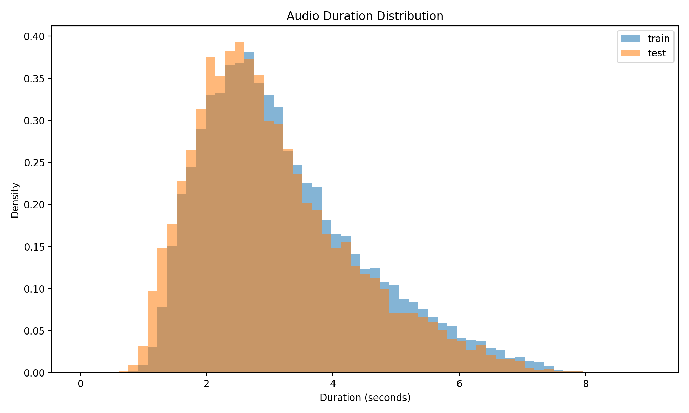

# ContextSpoof

Companion artifact for **ContextSpoof: A Mandarin Benchmark for Temporal Localization of LLM-Guided Speech Manipulation**.

## Overview

ContextSpoof is a Mandarin benchmark for temporal localization of LLM-guided partial speech manipulation. It studies recordings in which one or more short semantic units are edited, synthesized with zero-shot TTS, and reintegrated into an otherwise bona fide utterance. Construction-time labels specify the manipulated spans.

The benchmark covers four manipulation types (Negation Tampering, Entity Replacement, Quantity Tampering, and Detail Injection), four zero-shot TTS systems, and four reintegration methods. Its paper describes the construction protocol, source-utterance-level split, and evaluation setup.

### Current Benchmark Snapshot

The current manuscript reports **170,848 clips** (approximately 160 hours): 85,424 bona fide clips and 85,424 partially spoofed counterparts, derived from AISHELL-3. The source recordings are filtered to 1.5–8.0 seconds and preprocessed as 16-kHz mono audio with loudness normalized to −23 LUFS.

| Partition | Bona fide | Partially spoofed | Total |
| --- | ---: | ---: | ---: |
| Training | 37,359 | 37,359 | 74,718 |
| Validation | 24,906 | 24,906 | 49,812 |
| Test: seen speakers | 9,811 | 9,811 | 19,622 |
| Test: unseen speakers | 13,348 | 13,348 | 26,696 |
| **All partitions** | **85,424** | **85,424** | **170,848** |

All derivatives of a source utterance stay in one partition. Seen-speaker test clips contain new utterances from speakers represented in training; unseen test speakers are absent from both training and validation. **Phase-Aligned Crossfade is held out from training and validation**, appearing only in 5,771 partially spoofed test clips. The TTS, edit, and reintegration categories are attributes of the same clips, not separate datasets to be added together.

### Method and Reported Results

The paper proposes a text-independent localizer combining an EAT acoustic encoder, a Conformer with boundary gating, a bidirectional LSTM, and a linear-chain CRF. It predicts four positional labels: **B** (bona fide background), **O** (manipulation onset), **I** (interior), and **E** (offset). Boundary-weighted frame supervision supplements the CRF objective, and Cross-Segment Mixing is used only during training. Transcripts support dataset construction and inspection; they are not required at inference.

The proposed method achieves **97.2 ± 0.1% Event-F1** on partially spoofed test clips and **1.99 ± 0.23% clip-level EER** on the balanced full test set. These are manuscript-reported means and standard deviations over three initializations, not scores computed from the four review examples. The primary comparison retrains RawNet2, AASIST, PSD-L, IFBDN, and CFPRF under the common ContextSpoof protocol. Condition-wise and ablation analyses use one fixed seed.

For event-level evaluation, both predicted boundaries must lie within 200 ms of the construction-time reference boundaries. Segment-F1 is a separate overlap metric requiring **IoU > 0.5**. Clip-level EER uses the maximum frame-level spoof probability in each utterance. Boundary-error analysis independently pairs each reference span with its highest-IoU available prediction, permitting a prediction to be reused; short events have a reference duration **below 300 ms**. A clip can contain multiple reference events, so event counts need not equal clip counts.

See [Benchmark and Evaluation Details](docs/benchmark.md) for the construction factors, complete main-results table, evaluation scope, training settings, and reported condition-wise and ablation findings.

### Duration Distribution



The figure compares the normalized distribution of total clip duration in the training-side data (training and validation combined; labeled `train` in the figure) and the test set. It describes full-clip duration, not manipulated-span duration. The existing plot is retained; this review package does not include the underlying duration lists or plotting script needed to regenerate it against a new dataset revision.

## Review Artifact

This repository is a compact companion artifact for double-blind review. It supports qualitative inspection of representative source and manipulated pairs and verification of the sample metadata format through four audio pairs, waveform visualizations, and a machine-readable manifest in [`audio_samples/samples.json`](audio_samples/samples.json). The examples were selected from ContextSpoof to cover all four manipulation types; they are reviewer-facing examples rather than evaluation samples.

Each waveform preview juxtaposes the source audio, the construction-time reference interval, and a model prediction generated for qualitative illustration. Aggregate evaluation results are reported in the paper.

The package does **not** contain the full dataset, split manifests, model checkpoints, or executable training/evaluation code. No checkpoint or seed provenance accompanies the existing prediction images, so they should not be treated as verified outputs of the current paper's final model. The four examples do not establish any particular training/test or speaker-subset membership.

The bundled `*_Real.wav` source previews are 44.1-kHz mono files; the manipulated previews are 16-kHz mono files. This review-pair packaging differs from the benchmark's documented 16-kHz preprocessing. Use each file's actual sample rate and timeline rather than assuming sample-index alignment between the two recordings. [Sample Metadata](docs/sample-metadata.md) documents these details and the compatibility mapping from existing JSON keys to the current paper terminology.

| Manipulation | Synthesis | Reintegration |
| --- | --- | --- |
| Quantity Tampering | F5-TTS | Crossfade |
| Detail Injection | Spark-TTS | Overlap-Add |
| Entity Replacement | IndexTTS | Phase-Aligned Crossfade |
| Negation Tampering | CosyVoice | Zero-Crossing Cut |

### Suggested Inspection

1. Compare each `*_Real.wav` file with its corresponding manipulated file.
2. Use `*_viz.png` to inspect the construction-time manipulated interval and the illustrative prediction.
3. Check the transcript edit, timestamps, TTS system, and reintegration method in `audio_samples/samples.json`.
4. Read the [evaluation protocol](docs/benchmark.md#evaluation-protocol) before interpreting a preview as evidence about benchmark performance.

## Post-Acceptance Release Plan

Upon acceptance, we plan to prepare a versioned archival release containing:

1. the ContextSpoof dataset and integrity checksums;
2. the prompts, generation settings, and model configurations used to construct the benchmark;
3. source-utterance-disjoint split manifests and machine-readable metadata;
4. training, inference, and evaluation code with environment specifications; and
5. the baseline implementations and experiment configurations used in the paper.

The release will preserve the evaluation protocol described in the paper and document the provenance of each artifact. The final contents and redistribution terms will follow the licenses of AISHELL-3 and the third-party LLM and TTS systems.

## Repository Layout

```text
README.md                       # Review artifact, scope, and current benchmark overview
docs/
  benchmark.md                  # Current manuscript's setup, protocol, and reported results
  sample-metadata.md            # Sample schema, audio formats, and terminology mapping
duration_distribution.png       # Train/test clip-duration distribution
audio_samples/
  samples.json                  # Sample-pair manifest and construction-time spans
  *_Real.wav                    # Source audio previews
  *_<Type>_<TTS>_<Method>.wav   # Manipulated audio previews
  *_viz.png                     # Source/reference/prediction waveform previews
```

## Responsible Use

The materials are provided for research on multimedia verification and temporal localization. They should not be used to misrepresent a speaker or to facilitate deceptive audio editing.

## License

No license is granted for this review package. Licensing terms for released code, generated assets, and associated metadata will be provided with the public release.
